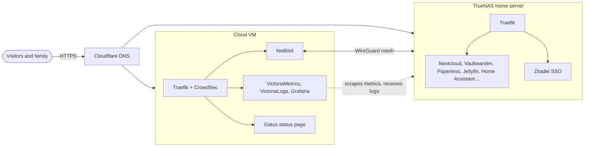

<h1 align="center">Infrastructure</h1>

<p align="center">
  <strong>The infrastructure I designed, built and run for my family, entirely as code.</strong><br>
  Two servers, about 45 self-hosted services, single sign-on, a mesh VPN, intrusion prevention and
  full observability: deployed with Ansible, Docker Compose and OpenTofu, tested in CI.
</p>

<p align="center">
  <a href="https://github.com/AlixANNERAUD/Infrastructure/actions/workflows/lint.yml"></a>
  <a href="https://etat.anneraud.fr/"></a>
  <a href="https://www.anneraud.fr/documentation/"></a>
  <a href="https://alix.anneraud.fr/"></a>
</p>

<p align="center">
  
  
  
  
  
  
  
</p>

---

This repository is the production infrastructure of my family's digital life (passwords,
documents, photos, home automation, chat), hosted on hardware we own rather than in someone
else's cloud. I treat it like software: every service, route, DNS record, login, alert and
dashboard is a reviewed file, linted and tested in CI, then applied with one command. It is also
where I practise what I care about as an engineer: security by default, observability, and
automation that is boring to operate.

## At a glance

| | |
| --- | --- |
| **Servers** | A TrueNAS SCALE home server (ZFS) and a cloud VM, joined by a NetBird mesh VPN |
| **Services** | About 45: Nextcloud, Vaultwarden, Paperless-ngx, Jellyfin, Home Assistant, Matrix Synapse, Gitea, Open WebUI… ([full list](#services)) |
| **Deployment** | 20 Compose stacks from this repository through one shared Ansible role; TrueNAS apps routed by it |
| **Identity** | Zitadel single sign-on, its organization and OIDC applications provisioned with OpenTofu |
| **Edge** | Traefik v3, wildcard Let's Encrypt certificates over Cloudflare DNS, CrowdSec, per-client rate limits |
| **Observability** | VictoriaMetrics, VictoriaLogs and Grafana, alerts to phones, an MCP server for LLM queries |
| **Quality** | 8 CI jobs, including ones that boot the real stacks; weekly Dependabot updates |

## Architecture



## Engineering highlights

- **Tested like application code.** CI does not stop at linting: it boots Traefik with its real
  routes, CrowdSec and its bouncer (and checks that a scanner gets banned and an IPv6 client keeps
  its own address), and VictoriaMetrics with Grafana, feeding synthetic metrics and checking that
  every dashboard query is valid and every alert fires when it should. Ansible roles have Molecule
  scenarios, OpenTofu configurations are validated and tested.
- **Secure by default.** Private services only answer the LAN and the VPN; nothing internal is
  published, metrics and APIs stay on internal Docker networks; containers drop the capabilities they do not need and
  read the Docker socket through read-only proxies; secrets live in Ansible Vault in a private
  submodule and the OpenTofu state is encrypted; SSH keys are restricted by source network and
  forced commands.
- **Identity as code.** The whole Zitadel organization (policies, users, OIDC clients for each
  service) is OpenTofu, and services pick up their client credentials at deploy time.
- **Observable.** Host, container, Traefik and CrowdSec metrics, Traefik's access logs, Grafana
  dashboards and alert rules are all provisioned from this repository; Grafana's MCP server gives
  an LLM read-only access to them for investigations.
- **Small, repeatable building blocks.** Every service is a folder with a playbook and a Compose
  file, deployed by one shared role that creates folders, writes secrets, starts the stack and
  publishes its DNS records; toolchains are pinned with uv and mise; deployments also run from
  Semaphore on the server itself.

## Documentation

How it all fits together is documented, in French, on **[www.anneraud.fr](https://www.anneraud.fr/documentation/)**:

| Page | Answers |
| --- | --- |
| [Architecture](https://www.anneraud.fr/documentation/architecture) | Which server does what, how a request reaches a service, how single sign-on works |
| [Network](https://www.anneraud.fr/documentation/reseau) and [DNS](https://www.anneraud.fr/documentation/dns) | How sites, the VPN and Docker networks are addressed and named |
| [Security](https://www.anneraud.fr/documentation/securite) | Which protections a request goes through, how access and secrets are managed |
| [Deployment](https://www.anneraud.fr/documentation/deploiement) | How a change goes from this repository to the servers |
| [Monitoring](https://www.anneraud.fr/documentation/supervision) and [backups](https://www.anneraud.fr/documentation/sauvegardes) | How failures are detected, where data is copied and how to restore it |

The rest of this file is the operator's reference: the service list, then how to deploy and run
each part.

## Inventory

Hosts and the service-to-host mapping are in [inventory/hosts.yml](inventory/hosts.yml); per-host settings are in [inventory/host_vars/](inventory/host_vars/).

## Services

| Name                                                                   | Description                                  | Access  | Server     | Deployment   | Status                                                                                                                             |
| ---------------------------------------------------------------------- | -------------------------------------------- | ------- | ---------- | ------------ | ---------------------------------------------------------------------------------------------------------------------------------- |
| [Accueil](https://wwww.anneraud.fr/)                                   | Services homepage                            | Public  | Bruxelles  | TrueNAS Apps |                                         |
| [Bichon](https://archive-courriel.anneraud.fr/)                         | Email archive                                | Private | Bruxelles  | TrueNAS Apps |                                         |
| [Bitwarden](https://bitwarden.anneraud.fr/)                            | Password manager (Vaultwarden)               | Public  | Bruxelles  | TrueNAS Apps |                                       |
| [Collabora](https://collabora.anneraud.fr/)                            | Online office suite                           | Public  | Bruxelles  | TrueNAS Apps |                                      |
| [Nuage](https://nuage.anneraud.fr/)                                    | Cloud storage and collaboration (Nextcloud)  | Public  | Bruxelles  | TrueNAS Apps | /uptimes/30d/badge.svg>)                            |
| [Automatisation](https://automatisation.anneraud.fr)                   | Workflow automation (n8n)                    | Private | Bruxelles  | TrueNAS Apps | /uptimes/30d/badge.svg>)                         |
| [Maison](https://maison.anneraud.fr/)                                  | Home automation (Home Assistant)             | Public  | Bruxelles  | TrueNAS Apps | /uptimes/30d/badge.svg>)                      |
| [Médiathèque](https://mediatheque.anneraud.fr/)                        | Media server (Jellyfin)                      | Public  | Bruxelles  | TrueNAS Apps | /uptimes/30d/badge.svg>)                       |
| [MeTube](https://metube.anneraud.fr/)                                  | Video downloader                              | Private | Bruxelles  | TrueNAS Apps |                                          |
| [MeshCentral](https://parc.anneraud.fr/)                               | Remote device management                      | Private | Bruxelles  | TrueNAS Apps |                                     |
| [Téléchargement](https://telechargement.anneraud.fr/)                  | Download manager (qBittorrent)               | Private | Bruxelles  | Ansible      | /uptimes/30d/badge.svg>)                 |
| [Matrix](https://matrix.anneraud.fr/)                                  | Matrix server (Synapse)                      | Public  | Bruxelles  | Ansible      | /uptimes/30d/badge.svg>)                             |
| [Archive](https://archive.anneraud.fr/)                                | Document management (Paperless-ngx)          | Private | Bruxelles  | TrueNAS Apps | /uptimes/30d/badge.svg>)                      |
| [Statistiques](https://s.anneraud.fr/)                                 | Analytics (Umami)                            | Public  | Bruxelles  | TrueNAS Apps | /uptimes/30d/badge.svg>)                         |
| [Notes](https://notes.anneraud.fr/)                                    | Documentation (Docmost)                      | Public  | Bruxelles  | Ansible      | /uptimes/30d/badge.svg>)                              |
| [Déploiement](https://deploiement.anneraud.fr/)                         | Ansible web UI (Semaphore)                   | Private | Bruxelles  | Ansible      | /uptimes/30d/badge.svg>) |
| [Assistant](https://assistant.anneraud.fr/)                            | AI assistant (Open WebUI)                    | Private | Bruxelles  | TrueNAS Apps | /uptimes/30d/badge.svg>)                       |
| [Recherche](https://recherche.anneraud.fr/)                            | Search engine (SearXNG)                      | Private | Bruxelles  | TrueNAS Apps | /uptimes/30d/badge.svg>)                           |
| [Authentification](https://authentification.anneraud.fr/)              | Identity provider (Zitadel)                  | Public  | Bruxelles  | Ansible      | /uptimes/30d/badge.svg>)                   |
| [PDF](https://pdf.anneraud.fr/)                                        | PDF management (BentoPDF)                    | Private | Bruxelles  | TrueNAS Apps | /uptimes/30d/badge.svg>)                               |
| [Mini Train Store](https://minitrainstore.fr/)                         | Business management (Odoo)                   | Public  | Bruxelles  | TrueNAS Apps | /uptimes/30d/badge.svg>)                      |
| [Git](https://git.anneraud.fr/)                                        | Git forge (Gitea)                            | Private | Bruxelles  | TrueNAS Apps | /uptimes/30d/badge.svg>)                                  |
| [Finances](https://finances.anneraud.fr/)                              | Personal finance manager (Firefly III)       | Private | Bruxelles  | TrueNAS Apps | /uptimes/30d/badge.svg>)                       |
| [Importateur finances](https://importeur-finances.anneraud.fr/)        | Finance data importer (Firefly III importer) | Private | Bruxelles  | TrueNAS Apps | /uptimes/30d/badge.svg>)  |
| [Recettes](https://recettes.anneraud.fr/)                              | Recipe manager (Mealie)                      | Private | Bruxelles  | TrueNAS Apps | /uptimes/30d/badge.svg>)                            |
| [Portefolio Alix](https://alix.anneraud.fr/)                           | Personal portfolio (GitHub Pages)            | Public  | -          | -            | /uptimes/30d/badge.svg>)               |
| [Radarr](https://radarr.anneraud.fr/)                                  | Movie collection manager                     | Private | Bruxelles  | TrueNAS Apps |                                          |
| [Sonarr](https://sonarr.anneraud.fr/)                                  | TV show collection manager                   | Private | Bruxelles  | TrueNAS Apps |                                          |
| [Prowlarr](https://prowlarr.anneraud.fr/)                              | Indexer manager                              | Private | Bruxelles  | TrueNAS Apps |                                        |
| [Bazarr](https://bazarr.anneraud.fr/)                                  | Subtitle manager                             | Private | Bruxelles  | TrueNAS Apps |                                          |
| [Jellyseerr](https://jellyseerr.anneraud.fr/)                          | Media request manager                        | Private | Bruxelles  | TrueNAS Apps |                                      |
| [Wakapi](https://wakapi.anneraud.fr)                                   | Coding time tracker                          | Public  | Bruxelles  | Ansible      |                                          |
| [Translation](https://translate.anneraud.fr/)                          | Translation platform (Tolgee)                | Public  | Luxembourg | Ansible      | /uptimes/30d/badge.svg>)                         |
| [Vault Xila](https://vault.xila.dev/ui/)                                | Xila signing service (OpenBao)               | Private | Bruxelles  | Ansible      |                               |
| [Proxy Bruxelles](https://traefik.bruxelles.anneraud.fr/)              | Reverse proxy (Traefik)                      | Private | Bruxelles  | Ansible      | /uptimes/30d/badge.svg>)              |
| [DNS dynamique Bruxelles](https://ddns-updater.bruxelles.anneraud.fr/) | Dynamic DNS updater                          | Private | Bruxelles  | TrueNAS Apps | /uptimes/30d/badge.svg>) |
| [Bruxelles console](https://bruxelles.anneraud.fr/)                    | Server management (TrueNAS)                  | Private | Bruxelles  | TrueNAS Apps | /uptimes/30d/badge.svg>)            |
| [Conteneurs Bruxelles](https://conteneurs.bruxelles.anneraud.fr/)      | Container management (Portainer)             | Private | Bruxelles  | TrueNAS Apps | /uptimes/30d/badge.svg>)       |
| [Databasus](https://databasus.anneraud.fr/)                            | Database management (Adminer)                | Private | Bruxelles  | TrueNAS Apps |                     |
| [Cockpit (Luxembourg)](https://cockpit.luxembourg.anneraud.fr/)        | Server management (Cockpit)                  | Private | Luxembourg | Ansible      | /uptimes/30d/badge.svg>)                      |
| [Vigie](https://vigie.anneraud.fr/)                                    | Monitoring (VictoriaMetrics, Grafana)        | Private | Luxembourg | Ansible      | /uptimes/30d/badge.svg>)                           |
| Métriques                                                              | Host and container metrics (node_exporter, cAdvisor), Traefik access log shipper (Vector) | Private | Luxembourg, Bruxelles | Ansible      | -                                                                                                                                     |
| Protection (Luxembourg)                                                | Intrusion prevention (CrowdSec)              | Private | Luxembourg | Ansible      | -                                                                                                                                  |
| [État](https://etat.anneraud.fr/)                                      | Service status page                          | Public  | Luxembourg | Ansible      | -                                                                                                                                  |
| [VPN](https://netbird.anneraud.fr/)                                    | Virtual private network (Netbird)            | Public  | Luxembourg | Ansible      | /uptimes/30d/badge.svg>)                          |
| [VPN console](https://netbird.anneraud.fr/admin/)                      | VPN administration console                   | Public  | Luxembourg | Ansible      | /uptimes/30d/badge.svg)                              |
| [Matrix](https://matrix.insa.lol/)                                     | Decentralized communication platform         | Public  | Luxembourg | Ansible      | -                                                                                                                                  |
| [Status (dera.page)](https://status.dera.page/)                        | Service status page                          | Public  | Luxembourg | Ansible      | -                                                                                                                                  |

## Deployment

Install [uv](https://docs.astral.sh/uv/) and [mise](https://mise.jdx.dev/), then the pinned tools (Ansible, ansible-lint, yamllint, OpenTofu for Zitadel) and Ansible collections:

```bash
mise install
mise run setup
```

Common commands are mise tasks (`mise tasks` lists them). They run with the tools from `mise.toml` on `PATH`, so OpenTofu is there for the Zitadel role. Arguments are passed on to the command:

```bash
mise deploy services/<service_name>/deploy.yml   # deploy one service
mise deploy site.yml --limit bruxelles           # everything on one host (or everything without --limit)
mise preview site.yml --limit bruxelles          # what would change (--check --diff), without changing it
mise vault vault/<service_name>/vault.yml        # edit a vault file
mise lint                                        # yamllint, ansible-lint, docker compose config
mise test                                        # Molecule scenarios of the roles (needs Docker)
```

`mise deploy …` is short for `mise run deploy …` and for `mise exec -- uv run ansible-playbook …`.

## Ansible account

Ansible connects to every host as `ansible`: SSH keys only, passwordless sudo, locked password. The authorized keys (`automation_public_keys` in `inventory/group_vars/all.yml`) are the laptop's (`automation_laptop_public_key`, written in the file so that Semaphore can run the bootstrap too) plus the other controllers' keys listed in `automation_additional_public_keys` (Semaphore's, see below). Each is accepted only from the networks in `automation_ssh_sources`, and no other key is kept in `authorized_keys`. The exception is on Bruxelles (TrueNAS): the controllers' keys, which connect from containers on the `proxy` network, are also accepted from that network's current subnet. To rotate the laptop's key, generate a new one (`ssh-keygen -t ed25519-sk` for a hardware-backed key is recommended), replace `automation_laptop_public_key` with its public key and run `mise deploy hosts/bootstrap.yml` on every host (and update the TrueNAS Authorized Keys line it prints), using the old key for that run.

Set it up, or update it, with:

```bash
mise deploy hosts/bootstrap.yml --limit <host>                                # existing host
mise deploy hosts/bootstrap.yml --limit <host> -u <you> --ask-become-pass     # new host, added to the inventory first
```

The playbook also hardens `sshd` (no passwords, no root login, only `ansible` and `ssh_administrators`). It refuses to run if the current connection doesn't come from an allowed network. When a host can't be reached, or sudo needs a password nobody provided, it prints the commands to run on that host by hand and skips it.

**TrueNAS (Bruxelles)** manages users and `sshd` in its own interface, which would undo changes made over SSH. The playbook only checks it (reachable, every key with its `from=` restriction, passwordless sudo, password login off) and prints what to change in the interface.

### Replication

`hosts/replication.yml` gives each client in the `replication` group a `replication` account and key, and installs a forced command on Bruxelles that runs one TrueNAS replication task, so the TrueNAS API key never leaves Bruxelles. Once, before deploying it:

1. Deploy: `mise deploy hosts/replication.yml`. Until the `replication` user exists in TrueNAS, it explains how to create it.
2. Paste the `command="…",restrict ssh-ed25519 …` lines it prints into that user's *Authorized Keys*; it prints them only while they are missing.

## Deployment with Semaphore

[Semaphore](https://semaphoreui.com/) (`services/deploiement`, https://deploiement.anneraud.fr, private) runs the playbooks from Bruxelles. It is deployed with `mise deploy services/deploiement/deploy.yml`, which also generates the SSH key Semaphore connects to the hosts with (`keys/ansible` in the service folder) and prints its public key. Its secrets are in `vault/deploiement/vault.yml`: the admin account (`deploiement_admin_login`, `deploiement_admin_name`, `deploiement_admin_email`, `deploiement_admin_password`), `deploiement_access_key_encryption` and `deploiement_vault_repository_token`. The last one lets Semaphore clone the private `Infrastructure_vault` submodule: create it in GitHub > Settings > Developer settings > Fine-grained personal access tokens, with *Only select repositories* > `Infrastructure_vault` and the repository permission *Contents: Read-only*, an expiry, and a reminder to rotate it before then (update the vault and run the deployment again). The deployment gives it to git in the container through a credential helper limited to that repository (`gitconfig` and `git-credentials` in the service folder, mode `0600`); without it, the deployment still works and prints this step. Generate the encryption key with `head -c32 /dev/urandom | base64` (it encrypts the keys stored in Semaphore: losing it makes them unreadable). The `SEMAPHORE_ADMIN_*` variables only create the admin on the first start: changing them in the vault later does not change the account, use the interface. The database is an embedded SQLite file in `data/` of the service folder. `keys/ansible` on the host stays there as the recovery copy of Semaphore's private key (mode `0600`, owned by the container user). Keep it: if it is deleted, the next deploy generates a different key pair, which has to be authorized and pasted again.

People log in through Zitadel ("Zitadel" button, application `deploiement` in `opentofu/zitadel/applications.auto.tfvars`), next to the local admin, which stays as the fallback: Semaphore deploys this repository, so it must not depend on Zitadel. Semaphore finds an account by email and refuses a Zitadel login whose email belongs to a local account: give the local admin another email (Users) before the first Zitadel login, then make the account Zitadel creates an admin from the local one. The client is provisioned when the playbook runs from the laptop with mise; Semaphore's own runs keep the previous client (no tofu in its container).

Once, to authorize Semaphore on the hosts:

1. Add the printed public key to `automation_additional_public_keys` in `inventory/group_vars/all.yml`, then run `mise deploy hosts/bootstrap.yml`.
2. On TrueNAS, add the same key as a line of the `ansible` user's *Authorized Keys* (bootstrap prints the exact lines). Semaphore's SSH connections to Bruxelles itself come from its container's address on the `proxy` network (not NATed), which has no fixed subnet: on Bruxelles its key is accepted from the LAN and VPN plus the current subnet of `proxy`, read when bootstrap runs. If the `proxy` network is ever recreated, run `mise deploy hosts/bootstrap.yml --limit bruxelles` again and update that line. On the other hosts, the key is accepted from the LAN and VPN only.

Once, in the Semaphore interface:

1. Create the project `Infrastructure`.
2. Key store, add:
   - `ansible`: type SSH, login `ansible`, the content of `keys/ansible` (read it on Bruxelles, it is never committed);
   - `vault`: type Login with password, empty login, the Ansible Vault password (it is only used to decrypt the vault files);
   - `none`: type None, to clone the public repository.
3. Repositories: `https://github.com/AlixANNERAUD/Infrastructure.git`, branch `main`, key `none` (the repository is public). Semaphore updates submodules when it clones; the private vault submodule is cloned with the read-only token that the deployment gives git in the container (see above), nothing to configure here. It installs the collections of the root `requirements.yml` by itself.
4. Inventory: type File, path `inventory/hosts.yml` (relative to the repository), SSH key `ansible`. Ansible reads `host_vars` and `group_vars` next to the inventory file, so `inventory/host_vars/` and `inventory/group_vars/` are picked up.
5. Task templates, for `site.yml` and for each `services/<service>/deploy.yml` (and `hosts/*.yml` if wanted), each in two variants, with the vault password `vault`:
   - preview: CLI args `["--check", "--diff"]`;
   - run: no extra arguments.

Semaphore runs the ansible-core bundled in its image (2.20) while CI lints with 2.21: check the first `--check` run for differences.

Zitadel provisioning (OpenTofu) still runs from the laptop.

## Structure

```
inventory/              # Hosts, groups and per-host settings
roles/                  # Reusable roles (compose_service, ...)
services/
  <service>/            # One folder per deployable stack
    deploy.yml          # Ansible playbook
    compose.yml         # Docker Compose file
    ...                 # Templates and configuration it copies
hosts/                  # Host-level playbooks (bootstrap, replication, hosts/<host>/...)
dns/                    # One playbook per Cloudflare DNS zone
site.yml                # Deploys every service (DNS zones are applied with dns/*.yml)
vault/                  # Private submodule with encrypted secrets
.github/                # CI workflows and check scripts
```

## Protection

Every request to the `web-secure` entrypoint of a Traefik whose host is in the `protection` group (Luxembourg for now) goes through CrowdSec's bouncer, internal routes included. CrowdSec (`services/protection`) reads Traefik's JSON access log from its container output through a read-only Docker socket proxy, detects scans, brute force and known CVE probes with the hub's `crowdsecurity/traefik` collection (which includes `crowdsecurity/base-http-scenarios` and `crowdsecurity/http-cve`), and bans the address for 4 hours; it also receives the community blocklist. Its local API is only reachable by Traefik over the internal `protection` network. The bouncer ([crowdsec-bouncer-traefik-plugin](https://github.com/maxlerebourg/crowdsec-bouncer-traefik-plugin), `crowdsec@file` from `services/proxy/protection.yml.j2`) refreshes the banned addresses every 15 s, answers 403 to them, and lets everything through while CrowdSec is down. Behind Cloudflare it checks the visitor's address (the rightmost `X-Forwarded-For` address that is not Cloudflare's).

The LAN and the VPN (the networks of `internal-allowlist` in `services/proxy/policy.yml`) are never banned: they are in CrowdSec's `internal` allowlist, which drops alerts and refuses decisions on them, and the bouncer lets them through whatever CrowdSec says.

Public login pages are also rate limited per client address, on both hosts (POST requests to the login paths only, so app sync is not limited; Traefik answers 429 past the limit): `rate_limit` on a route in `inventory/host_vars/bruxelles/traefik.yml` for the TrueNAS Apps, and labels for the stacks of this repository: Zitadel on Bruxelles (with the limits of that same file, written to its `.env`), Tolgee and Netbird's login on Luxembourg.

Both depend on Traefik seeing each client's own address, IPv6 included. Its published ports go through its own dual-stack network (`ingress` in `services/proxy/compose.yml`, its gateway network through `gw_priority`), so Docker forwards IPv6 connections natively. On an IPv4-only network Docker's userland proxy relays them instead, and every IPv6 client shows up as that network's gateway: one rate limit bucket for all of them, and a CrowdSec ban on that address would lock them all out. This needs Docker 28 or later with `ip6tables` on (the default); `services/proxy/deploy.yml` checks both before deploying and checks Traefik's gateway after. To see the addresses Traefik logs on a host:

```bash
sudo docker logs traefik --since 30m 2>&1 | grep -o '"ClientHost":"[^"]*"' | sort | uniq -c | sort -rn | head
```

Prerequisites, once:

- `vault/protection/vault.yml` holds `protection_bouncer_key`, the key Traefik's bouncer authenticates with (`openssl rand -hex 32`), and optionally `protection_enrollment_key` to enroll the engine in the [CrowdSec console](https://app.crowdsec.net) (then accept it there and run `docker restart crowdsec`). `services/proxy/deploy.yml` loads this vault on every host, so it must exist.
- Deploy Traefik first, then CrowdSec: `mise deploy services/proxy/deploy.yml --limit luxembourg`, then `mise deploy services/protection/deploy.yml`.
- Traefik downloads the plugin from plugins.traefik.io when it starts. If that fails, every route of the host answers 404 (its routers miss the `crowdsec` middleware): restart Traefik (`docker restart traefik`) once the plugin site is back, or remove the host from the `protection` group and deploy Traefik again. Dependabot does not update the plugin version in `services/proxy/compose.yml`.
- The bouncer key is registered when CrowdSec starts and only if it is not registered yet. To change it: update the vault, `docker exec crowdsec cscli bouncers delete traefik`, deploy CrowdSec then Traefik, and `docker restart traefik`.

On the host:

```bash
docker exec crowdsec cscli decisions list                 # current bans
docker exec crowdsec cscli decisions delete --ip <address> # unban
docker exec crowdsec cscli alerts list                     # what was detected
docker exec crowdsec cscli allowlists inspect internal     # never banned
```

An unban reaches Traefik within 15 s. To add another host, add it to the `protection` group in `inventory/hosts.yml` and deploy Traefik then CrowdSec there.

Vigie monitors both protections (see [Vigie](#vigie)): the CrowdSec dashboard (alerts and bans per scenario and origin, lines read and parsed, local API and bouncer requests, 403 answers per router) and the Rate limits dashboard (429 answers per login router and per router on both Traefik instances, from Traefik's own metrics). VictoriaMetrics scrapes CrowdSec's metrics (`crowdsec:6060`) over the internal `protection-metrics` network, which both playbooks create and only these two containers join; nothing is published. That port also serves Go's profiling pages and CrowdSec's local API listens next to it (it asks for credentials), so keep Grafana and other services off that network.

## Vigie

Vigie (`services/vigie`) runs on Luxembourg: VictoriaMetrics (3 months of retention, 30 s scrape interval), VictoriaLogs (Traefik's access logs, [below](#traefik-access-logs)) and Grafana at `https://vigie.anneraud.fr/`, reachable only through Traefik's internal allowlist. It scrapes the metrics of both Traefik instances (Luxembourg and Bruxelles), the host and container metrics of both hosts (`services/metriques`, below) and CrowdSec on Luxembourg (see [Protection](#protection)). Grafana alerts a Home Assistant webhook on 5xx errors, high latency and unreachable targets (group Traefik), on filesystems over 90 % full, ZFS pools not `ONLINE`, memory over 90 % for 15 minutes, CPU over 90 % for 30 minutes and missing host metrics (group Hosts), and on the protections (group Protection, below). Its dashboards are Traefik, Traefik logs, Hosts, CrowdSec and Rate limits (`services/vigie/grafana/dashboards/`); Hosts shows CPU, memory, filesystems, the free space of ZFS pools and the CPU and memory of every app (Compose project, TrueNAS Apps without their `ix-` prefix) and container.

The Protection alert group (`services/vigie/grafana/protection_alerting.yml.j2`) sits above the background of scanners on a public address, so only what is out of the ordinary reaches the phone:

| Alert | Fires when |
|---|---|
| CrowdSec metrics missing | CrowdSec cannot be scraped for 10 minutes |
| CrowdSec bouncer silent | CrowdSec answers but Traefik's bouncer has not asked it for decisions for 20 minutes: bans are not applied |
| CrowdSec reads no access log | Traefik serves requests but CrowdSec parsed none of its log lines in 30 minutes |
| CrowdSec alert spike | More than 30 CrowdSec alerts (scenario overflows, each a 4-hour ban) in an hour |
| Login rate limit spike | A login router (`*-login`) answers more than 50 requests with 429 in 15 minutes, on either host |

The CrowdSec rules and scrape job only exist when Vigie's host is in the `protection` group: Vigie only reaches the CrowdSec of its own host. Grafana login goes through Zitadel (role `vigie-admin` maps to Grafana `Admin`, everyone else is `Viewer`); the local admin login stays available as a fallback.

Prerequisites:

- `vault/vigie/vault.yml` holds `vigie_grafana_admin_password` and `vigie_home_assistant_webhook_id`.
- Home Assistant has an automation with a webhook trigger whose id is `vigie_home_assistant_webhook_id`, with `local_only: false` (Grafana calls it through `maison.anneraud.fr` from Luxembourg, not from the home network).
- `vigie_grafana_admin_password` only applies on Grafana's first start, when it creates its database. To rotate it afterwards, run `docker exec -it vigie-grafana-1 grafana cli admin reset-admin-password <new password>` on Luxembourg, then update the vault.
- `vault/authentification/vault.yml` holds `zitadel_automation_token` and `zitadel_state_passphrase`. Without them, the deploy goes on with OAuth off and only the local admin login. If provisioning fails, Grafana keeps the Zitadel login of the previous deploy (OAuth stays off when there was none). When the apply changes the applications, commit `vault/authentification/opentofu.tfstate` in the vault repository.
- The deploy provisions the Zitadel application with OpenTofu, so run it with `mise deploy services/vigie/deploy.yml` (mise puts `tofu` on `PATH`). A missing `tofu` means the playbook was run without mise.
- The Bruxelles scrape goes from Luxembourg to Bruxelles over Netbird and relies on Bruxelles' Traefik internal allowlist accepting the VPN range.
- The CrowdSec scrape needs CrowdSec's stack deployed on the `protection-metrics` network (`mise deploy services/protection/deploy.yml`); until then, CrowdSec metrics missing fires.

### Grafana in MCPHub

Vigie also runs Grafana's official MCP server (`grafana/mcp-grafana`, service `mcp`) at `https://vigie.anneraud.fr/mcp`, behind the internal allowlist: from MCPHub, an assistant can query VictoriaMetrics (PromQL) and Traefik's access logs in VictoriaLogs (LogsQL), read the dashboards and the alert rules with their state. It has no write tools (`--disable-write`), reads Grafana with a Viewer service account, and refuses any request without its own bearer token. It only starts once both tokens are in `vault/vigie/vault.yml`, in order:

1. In Grafana, as an admin: Administration → Users and access → Service accounts → Add service account `mcp`, role **Viewer** → Add service account token (no expiration, or note when it expires).
2. `mise vault vault/vigie/vault.yml`: `vigie_mcp_grafana_token` (that token) and `vigie_mcp_server_token` (`openssl rand -hex 32`), then commit the vault and its pointer.
3. `mise deploy services/vigie/deploy.yml`: the `mcp` container starts (Compose profile `mcp`).
4. In MCPHub (Servers → Add): type Streamable HTTP, URL `https://vigie.anneraud.fr/mcp`, header `Authorization` = `Bearer <vigie_mcp_server_token>`. Every MCPHub user given this server sees all of Vigie's metrics: keep it in the owner's group.

### Traefik access logs

Vigie also keeps the access log of both Traefik instances for 14 days (at most 2 GiB, `vigie_logs_retention` and `vigie_logs_max_disk_space` in `inventory/group_vars/vigie.yml`) in VictoriaLogs, one record per request with Traefik's fields: `ClientHost`, `RequestHost`, `RequestMethod`, `RequestPath`, `DownstreamStatus`, `DownstreamContentSize`, `RouterName`, `ServiceName`, `request_User-Agent`, `Duration`… The Traefik logs dashboard filters them by host, client address, domain and status (text boxes, `*` for any) and shows requests by status over time, the top clients, errors by domain, the top paths with their answer size, and the matching requests. In Grafana, Explore → VictoriaLogs takes any LogsQL query, for instance:

```
ClientHost:="34.38.220.175" DownstreamStatus:=200 | fields _time, RequestHost, RequestPath, DownstreamContentSize, RouterName, request_User-Agent
RequestHost:="simrepo.dera.page" DownstreamStatus:>=400 | stats by (DownstreamStatus) count()
```

Through MCPHub, the same queries go through the MCP server's `query_loki_logs` tool (its Loki tools also query VictoriaLogs data sources, in LogsQL), with the data source `victorialogs`.

Vector (`services/metriques`, on both hosts) ships them: it reads the `traefik` container's output through a read-only Docker socket proxy, as CrowdSec does, and sends each line with its JSON fields (Traefik's own log lines keep their text). Nothing is published. On Luxembourg it reaches VictoriaLogs in the internal `metriques` Docker network; Bruxelles sends to `https://vigie.anneraud.fr/insert/jsonline` (POST only, VictoriaLogs' other endpoints are not routed), behind Luxembourg's internal allowlist, over Netbird. While VictoriaLogs is unreachable, Vector keeps up to 10,000 lines in memory and drops newer ones past that.

Deploy Vigie first (it downloads Grafana's VictoriaLogs data source plugin, checked against its release checksum, and restarts Grafana when it changes), then `mise deploy services/metriques/deploy.yml`. On Bruxelles the deploy posts an empty batch to Vigie and stops with the reason when it is refused: 403 means Bruxelles' address is outside Luxembourg's internal allowlist, no answer that Bruxelles cannot reach Luxembourg over Netbird.

### Host metrics

`services/metriques` runs on every host of the `metriques` group (Luxembourg and Bruxelles), deployed with `mise deploy services/metriques/deploy.yml`:

- node_exporter: CPU, memory, load, filesystems, ZFS' ARC and the state of each ZFS pool (from the kernel) of the host, read from its `/proc` and its root filesystem mounted read-only (`pid: host`, root without privileges except reading through closed folders).
- cAdvisor: CPU and memory of every container, labelled with its Compose project (`app`) and name (`container`); Vigie keeps only these series.
- Vector: ships Traefik's access log to Vigie's VictoriaLogs (see [Traefik access logs](#traefik-access-logs)).

The free space of a ZFS pool comes from its datasets' mounts; its capacity does not (node_exporter cannot read it), so TrueNAS' own alerts cover pools filling up, along with failing disks and scrubs: keep an alert service set in TrueNAS → System → Alert Settings.

Nothing is published. On Luxembourg the exporters share the internal `metriques` Docker network with VictoriaMetrics. Bruxelles (`metriques_host` in its host variables) serves them through its Traefik at `https://metriques.bruxelles.anneraud.fr/node/metrics` and `/containers/metrics`, behind the internal allowlist and covered by the `*.bruxelles.anneraud.fr` certificate; the deploy points that private name to Bruxelles. Deploy `services/metriques` before Vigie on a new host, then Vigie, which renders a node and a containers scrape job per host of the group.

## MCPHub

MCPHub (`services/mcphub`) runs on Bruxelles at `https://mcphub.anneraud.fr/`, behind Traefik's internal allowlist, in database mode with its own PostgreSQL (backed up by Databasus through the `databases` network). People log in through Zitadel (application `mcphub` in `opentofu/zitadel/applications.auto.tfvars`, provisioned by the deploy, which passes the client id and secret to MCPHub); the local `admin` login stays available as a fallback.

Prerequisites:

- `vault/mcphub/vault.yml` (`mise vault:create vault/mcphub/vault.yml`) holds `mcphub_database_password`, `mcphub_jwt_secret`, `mcphub_better_auth_secret` (`openssl rand -hex 32` each) and `mcphub_admin_password` (used only when MCPHub creates its first user).
- Deploy with `mise deploy services/mcphub/deploy.yml` (OpenTofu must be on `PATH`). Without the Zitadel credentials, only the local admin login is available.
- A first Zitadel login creates a regular MCPHub user named after the email (`alix@anneraud.fr`). Make it an administrator once from the local `admin` account (Users). Each user can then connect their own account to servers that use OAuth ("Connect" on the server), and servers are shared through their visibility (`private`, `group` or `public`).

### MCP clients

`mise deploy hosts/workstations/mcp.yml` points the workstation's MCP clients at MCPHub (`https://mcphub.anneraud.fr/mcp`, not `/mcp/$smart`, whose tool search needs pgvector and an embedding service MCPHub does not have), so every model reaches the same servers whatever its provider: Claude Code (through its CLI, user scope), Codex (`~/.codex/config.toml`), OpenCode (`~/.config/opencode/opencode.json`) and Antigravity (`~/.gemini/config/mcp_config.json`). Other settings of those files are kept; an OpenCode file with comments must lose them first. No key is written: the clients log in through MCPHub's OAuth, so its OAuth server must be enabled in MCPHub's settings. Restart the clients afterwards. Every enabled tool reaches the model's context: keep only the tools needed enabled on each MCPHub server (Paperless's `archive` server: its read tools only). The workstation must be on the LAN or Netbird (internal allowlist).

## TrueNAS apps

Apps installed in TrueNAS's interface on Bruxelles keep their configuration there, login through Zitadel included: TrueNAS can only replace an app's settings section as a whole (passwords and keys included), so this repository does not write it. A service's playbook provisions its Zitadel application and writes the environment variables to paste instead.

Paperless (`services/archive`): `mise deploy services/archive/deploy.yml` prints the three entries to add in TrueNAS → Apps → paperless-ngx → Edit → Additional Environment Variables, both with container `paperless`: `PAPERLESS_APPS`, with its value, and `PAPERLESS_SOCIALACCOUNT_PROVIDERS`, whose value holds the client secret and is written alone to `~/.config/infrastructure/zitadel/archive-providers.json` (0600) rather than printed, to copy into the Value field, and `PAPERLESS_SOCIALACCOUNT_ALLOW_SIGNUPS=false`: Paperless never links a Zitadel login to an existing account by itself, so this refuses unlinked logins instead of creating empty duplicate accounts. Keep the other entries; Paperless restarts when saved. Run it again only when the Zitadel application changes. The client secret is then visible to whoever can edit the app in TrueNAS. Existing Paperless users link their account once: log in with their Paperless password, then Profile → Connect a social account → Zitadel.

## Zitadel

OpenTofu (`opentofu/zitadel/`) owns the whole Anneraud organization: the organization itself (the instance's default), its domain `anneraud.fr`, its login, password, lockout, domain and label policies, its users and their roles, and the projects and OIDC applications of `applications.auto.tfvars`. The instance defaults are not managed, so the ZITADEL organization's admin stays a working fallback whatever the code does. Apply it with `mise deploy services/authentification/applications.yml`; deploys that need an application (Vigie) apply it too. The state is encrypted in `vault/authentification/opentofu.tfstate`: commit it in the vault repository after each change.

`vault/authentification/vault.yml` holds:

- `zitadel_automation_token`: personal access token of the `opentofu` service user of the ZITADEL organization, a manager of the instance with IAM_OWNER (Default settings → Managers).
- `zitadel_state_passphrase`: passphrase of the state (`openssl rand -base64 32`).
- `zitadel_smtp_host` (`host:port`), `zitadel_smtp_user`, `zitadel_smtp_password`: SMTP2GO credentials for Zitadel's emails, sent from `authentification@anneraud.fr`. Without a host, Zitadel sends no email.
- `zitadel_users`: the people, keyed by username, kept out of the public repository. The role refuses to run without them: an empty list would delete every user.

```yaml
zitadel_users:
  alix:
    email: alix@anneraud.fr
    first_name: Alix
    last_name: Anneraud
    owner: true                 # ORG_OWNER of Anneraud
    temporary_password: true    # written to ~/.config/infrastructure/zitadel/alix.password, changed at first login
    roles: {Vigie: [vigie-admin]}
    service_accounts: {nextcloud: Alix ANNERAUD}   # user metadata nextcloud_account, for linking existing accounts
  camille:                      # example
    email: camille@anneraud.fr  # an Infomaniak redirect to their own inbox
    first_name: Camille
    last_name: Example
    service_accounts: {nextcloud: Camille EXAMPLE}
```

Users without `temporary_password` get Zitadel's invitation email. Both only happen when the user is created: setting `temporary_password` on an existing user changes nothing in Zitadel (reset the password from the console instead). Logins read `<username>@anneraud.fr`.

A service deployed by this repository gets its login from the role's `login` entry point in its playbook's `pre_tasks`; the client id and secret come back as `zitadel_login_client_id` and `zitadel_login_client_secret`, for its `.env`. They are empty without the Zitadel credentials, and keep the previous deploy's values when provisioning fails:

```yaml
- name: Get MCPHub's Zitadel login
  ansible.builtin.include_role:
    name: zitadel
    tasks_from: login
  vars:
    zitadel_login_application: mcphub                         # key in applications.auto.tfvars
    zitadel_login_environment_file: "{{ services_root }}/MCPHub/.env"
    zitadel_login_client_id_variable: OIDC_CLIENT_ID          # names in that .env
    zitadel_login_client_secret_variable: OIDC_CLIENT_SECRET  # omitted for PKCE clients
```

For a service managed outside this repository, add an entry to `applications.auto.tfvars` (`authentication = "client_secret"` and `configured_in` when the service needs a secret pasted in) and run `mise deploy services/authentification/applications.yml`: it prints the issuer, client id and `configured_in`, and writes client secrets to `~/.config/infrastructure/zitadel/<application>.secret`.

## Vault

The vault password lives in the system keyring (Secret Service on Linux, Keychain on macOS, Credential Locker on Windows). `mise.toml` points Ansible at `vault-password-client.py`, which reads it from there. The first time on a machine, the first command that needs it asks for it, checks it against `vault/ansible/vault.yml` and stores it. Nothing to source.

```bash
mise vault vault/<service>/vault.yml            # edit (EDITOR, e.g. in mise.local.toml: [env] EDITOR = "zed --wait")
mise exec -- uv run ansible-vault view vault/<service>/vault.yml
./vault-password-client.py --forget             # after changing the password, or to remove it from this machine
```

`ANSIBLE_VAULT_PASSWORD`, when set, takes precedence over the keyring (for machines without one).
